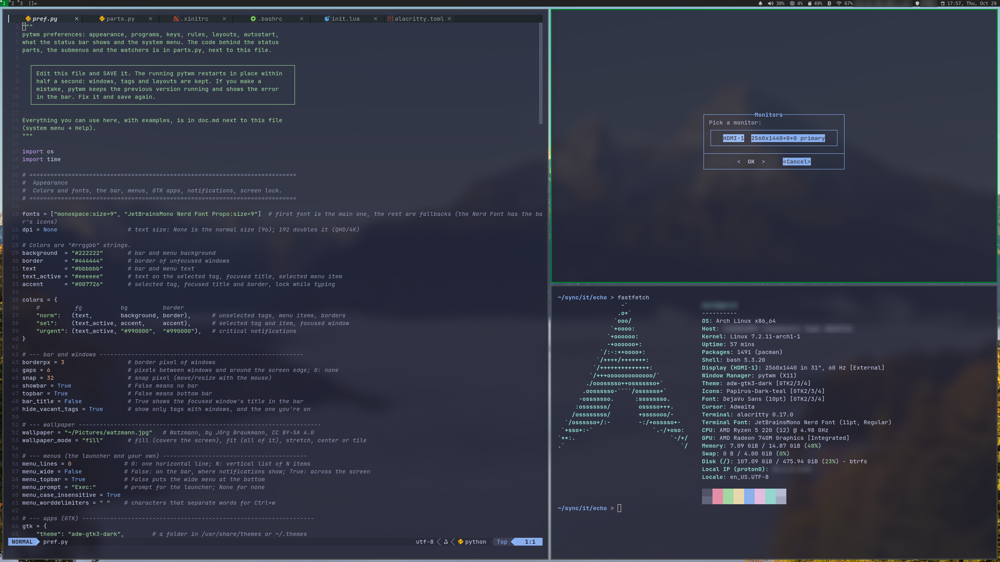

# pytwm

pytwm is a tiling window manager for X11, written in Python, with a program launcher,
status bar, screen lock and notifications. This repository also sets up an Arch Linux
desktop around it.



## Install

Requires Arch Linux.

```sh
git clone https://github.com/davidnsousa/pytwm
cd pytwm
bash setup.sh
```

Then reboot and run `startx`.

`setup.sh` installs the packages, enables the services and copies the files in
[filesystem/home/user](filesystem/home/user/) to your home folder.

## Use

Settings are in `~/.config/pytwm/pref.py` and apply when you save. The documentation
is [doc.md](filesystem/home/user/.config/pytwm/doc.md), also in system menu → Help
(Super+s). System menu → Keys lists your keys.

Errors are written to `~/.local/state/pytwm/pytwm.log`.

## Update

Run `setup.sh` again from a newer copy of the repository. It replaces all files
except `pref.py`: if yours differs, it shows the differences and asks which to keep.

## Credits and license

pytwm is based on [dwm](https://dwm.suckless.org) 6.6,
[dmenu](https://tools.suckless.org/dmenu) 5.4 and [slock](https://tools.suckless.org/slock),
rewritten in Python with AI assistance (Claude).

pytwm is licensed under MIT ([LICENSE](LICENSE)). The licenses of the projects it is
based on are in [LICENSES](LICENSES/).

<sub>pytwm is a successor to [ddwm](https://github.com/davidnsousa/ddwm).</sub>
